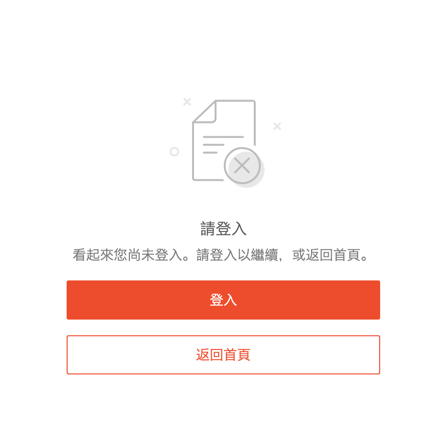
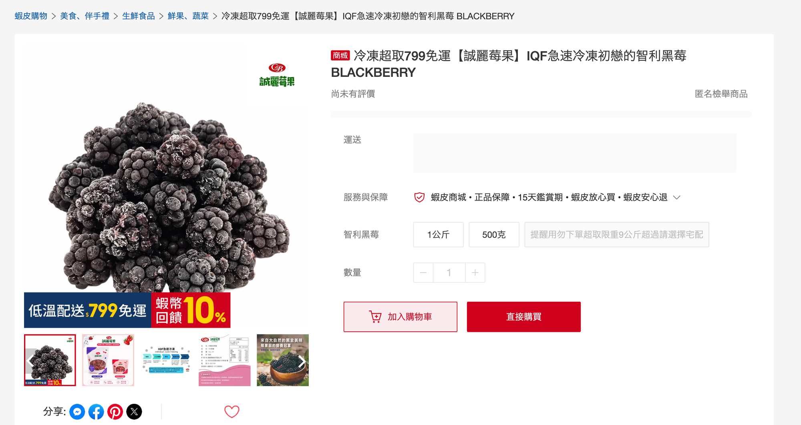

# Shopee Peek

**English** | [繁體中文](README.zh-TW.md) | [简体中文](README.zh-CN.md)

A userscript for viewing Shopee Taiwan (shopee.tw) product pages without logging in. Products render in Shopee's own page layout, with a BigGo reference price under the title.

| Without the script: login wall | With the script: Shopee's own product page |
|---|---|
|  |  |

## What you see while logged out

| Visible | Not visible |
|---|---|
| Title, image gallery | Units sold |
| Variant options | Ratings and reviews |
| Spec table, description | Shipping options and fees |
| Shop name, response rate, followers | Live prices (BigGo can lag behind) |
| BigGo reference price per variant, follows your selection | Search pages after the first, prices in search results |
| Search results, first page (10 items with image and title) | |

Shopee removes units sold, reviews and shipping from logged-out responses on its servers, and no other source for them has turned up. Items BigGo hasn't indexed show 「查無價格」 ("no price found").

## Install

1. Install [Tampermonkey](https://www.tampermonkey.net/).
2. Chrome, Brave or Edge: open `chrome://extensions` → Tampermonkey → Details → turn on **Allow User Scripts**.
3. Open [shopee-peek.user.js](https://raw.githubusercontent.com/YTsnipers/shopee-peek/main/shopee-peek.user.js); Tampermonkey shows its install page.

Tampermonkey installs later versions automatically.

## Supported

- Site: shopee.tw only
- Tested: Brave + Tampermonkey. Untested: Chrome, Edge, Firefox, Violentmonkey.

## Troubleshooting

| Symptom | Cause | Fix |
|---|---|---|
| Still sent to the login page | Tampermonkey can't run user scripts yet, or Shopee changed its site | Check install step 2; if it's on, open an issue |
| A plain card with only title, image and price | Shopee is rate-limiting your IP, so the full product data isn't available | Wait a while, then reload |
| 「查無價格」 under the title | BigGo hasn't indexed this item | Nothing to fix; the rest of the page works |
| Shopee wants a captcha but the page never shows it | The script drops every in-page redirect to `/verify/`, logged in or not | Disable the script for that visit |

To report a bug, open the DevTools console, filter on `[Shopee Peek]`, and paste those lines into an issue with the product URL.

## How it works

Logged out, Shopee's product API (`/api/v4/pdp/get_pc`) answers with error `90309999`, and the frontend then redirects to the login wall. The script:

1. Hooks the page's `fetch`, `XMLHttpRequest` and `history` at `document-start`.
2. On a blocked `get_pc`, fetches the same product page with the LINE in-app browser's User-Agent. That version embeds product data in the same shape as `get_pc`, which the script hands to Shopee's frontend.
3. Fills in shop details from `get_shop_base`, answers the other blocked APIs with empty data, and drops redirects to `/verify/`.
4. Looks up per-variant prices on BigGo and shows them under the title.
5. On a blocked search, reads the search page's `ItemList` structured data and feeds it to Shopee's search page.

Logged in, Shopee's APIs never return `90309999`, so the script replaces no data.

Details: [docs/how-it-works.md](docs/how-it-works.md). What was tried and why it failed: [docs/investigation-log.md](docs/investigation-log.md). Both in Traditional Chinese.

## For AI assistants

- [`llms.txt`](llms.txt): purpose, behaviour, limits and file map in one file. To ask an AI chat about this project, give it `https://raw.githubusercontent.com/YTsnipers/shopee-peek/main/llms.txt`.
- [`AGENTS.md`](AGENTS.md): code layout, invariants and a manual test checklist for coding agents that edit the script.

## Contributing

Issues and PRs are welcome. To port the script to another Shopee region, start from the "Hard-coded to Taiwan" list in [`AGENTS.md`](AGENTS.md); whether the LINE User-Agent route works outside Taiwan is untested.

If the script saved you a login, a star helps other people find it.

## Disclaimer

This script is for personally viewing publicly available product information and is not affiliated with Shopee or its affiliates. It depends on how the site works today and may break after any site update; the author doesn't guarantee it keeps working. Users should weigh the risks and follow the site's terms of service; the author accepts no responsibility for any consequence of using the script.

## License

[MIT](LICENSE)
