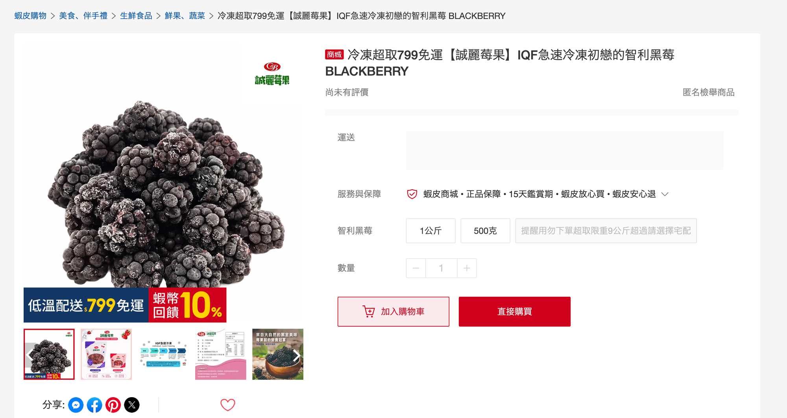

# Shopee Peek

[English](README.md) | [繁體中文](README.zh-TW.md) | **简体中文**

不登录也能看虾皮台湾（shopee.tw）商品页的油猴脚本。商品用虾皮原生页面显示，标题下方附 BigGo 参考价。

| 未安装：被挡在登录页 | 安装后：显示虾皮原生商品页 |
|---|---|
|  |  |

## 未登录时能看到什么

| 能看到 | 看不到 |
|---|---|
| 商品标题、多图轮播 | 销量 |
| 规格选项 | 评价 |
| 商品参数、商品详情 | 配送方式与运费 |
| 店铺名称、回复率、粉丝数 | 实时价格（BigGo 价格可能滞后） |
| 各规格 BigGo 参考价，随所选规格切换 | 搜索第 2 页以后、搜索结果里的价格 |
| 站内搜索第 1 页（10 条，含图片与标题） | |

销量、评价、配送信息由虾皮服务器对未登录访客直接移除，目前找不到其他来源。BigGo 没有收录的商品会显示「查無價格」（脚本界面为繁体中文，意为“查不到价格”）。

## 安装

1. 安装 [Tampermonkey](https://www.tampermonkey.net/)
2. Chrome、Brave、Edge：打开 `chrome://extensions` → Tampermonkey → 详情 → 开启「允许用户脚本」（Allow User Scripts）
3. 打开 [shopee-peek.user.js](https://raw.githubusercontent.com/YTsnipers/shopee-peek/main/shopee-peek.user.js)，Tampermonkey 会弹出安装页

之后的新版本由 Tampermonkey 自动安装。

## 支持范围

- 网站：仅支持 shopee.tw
- 已测试：Brave + Tampermonkey；未测试：Chrome、Edge、Firefox、Violentmonkey

## 常见问题

| 现象 | 原因 | 处理 |
|---|---|---|
| 仍然跳到登录页 | Tampermonkey 还不能运行用户脚本，或虾皮改版 | 检查安装第 2 步；已经开启就提 issue |
| 只出现标题、图片、价格的精简卡片 | 虾皮对你的 IP 限流，拿不到完整商品数据 | 等一段时间再刷新 |
| 标题下方显示「查無價格」 | BigGo 没有收录这个商品 | 无需处理，页面其他部分正常 |
| 虾皮要求验证码，页面却一直不出现 | 脚本会丢弃所有跳往 `/verify/` 的页内跳转，登录时也一样 | 本次浏览先停用脚本 |

反馈问题时，打开开发者工具的 Console（控制台），筛选 `[Shopee Peek]`，把这些信息连同商品链接贴到 issue。

### 限流

虾皮会限制同一个 IP 通过脚本所用的路径加载页面的频率。各路径被限流时的表现：

| 路径 | 被限流时 | 页面表现 |
|---|---|---|
| 商品数据（LINE User-Agent） | 返回 HTTP 200，但内嵌数据的 `cachedMap` 为空 | 显示 BigGo 精简卡片，而不是完整商品页；控制台出现 `[Shopee Peek] LINE 版回傳空資料` |
| 搜索（社交预览 User-Agent） | `facebookexternalhit`、`Twitterbot`、`Googlebot` 都返回 HTTP 403 + `90309999` | 搜索页显示「找不到結果」（意为“找不到结果”） |
| 首页推荐 | 虾皮返回空数据，不是脚本造成的 | 限流范围扩大时，首页「每日新發現」（每日新发现）也会变空 |

- 触发与解除：之前的测试大约 10 分钟内打开 8 次商品页就会触发，约 30 分钟后解除。另一次测试停用 65 分钟后，商品页仍是精简卡片、搜索仍显示「找不到結果」，首页推荐已恢复。
- 手动测试要间隔开，不要连续打开很多商品。
- 被限流后等 30 到 60 分钟再试。

## 工作原理

未登录时，虾皮商品 API（`/api/v4/pdp/get_pc`）返回 `90309999` 错误，前端随即把页面导向登录墙。脚本的处理：

1. 在 `document-start` 拦截页面的 `fetch`、`XMLHttpRequest`、`history`
2. `get_pc` 被挡时，用 LINE 内置浏览器的 User-Agent 重新请求同一个商品页。这个版本内嵌与 `get_pc` 同格式的商品数据，脚本把它交给虾皮前端渲染
3. 从 `get_shop_base` 补上店铺信息，其他被挡的 API 返回空数据，并丢弃跳往 `/verify/` 的跳转
4. 向 BigGo 查询各规格价格，显示在标题下方
5. 搜索被挡时，读取搜索页的 `ItemList` 结构化数据，交给虾皮原生搜索页

登录状态下虾皮 API 不会返回 `90309999`，脚本不替换任何数据。

细节见 [docs/how-it-works.md](docs/how-it-works.md)；试过哪些方法、为什么失败见 [docs/investigation-log.md](docs/investigation-log.md)。两份文档均为繁体中文。

## 给 AI 助手

- [`llms.txt`](llms.txt)：用途、行为、限制与文件地图汇总在同一个文件（英文）。想问 AI 这个项目，把 `https://raw.githubusercontent.com/YTsnipers/shopee-peek/main/llms.txt` 发给它
- [`AGENTS.md`](AGENTS.md)：代码结构、不能破坏的规则与手动测试清单，供要修改脚本的 AI 编程助手阅读

## 参与贡献

欢迎提 issue 和 PR。想移植到其他地区的虾皮，先看 [`AGENTS.md`](AGENTS.md) 的「Hard-coded to Taiwan」清单；LINE User-Agent 这条路在台湾以外是否有效尚未测试。

如果脚本帮你省下了一次登录，点个 star 能让更多人找到它。

## 免责声明

本脚本仅供个人浏览公开商品信息，与 Shopee 及其关联企业无任何关系。脚本依赖网站目前的运作方式，网站更新后可能随时失效，作者不保证功能持续有效。使用者应自行评估使用风险并遵守网站服务条款，作者不对使用本脚本造成的任何后果负责。

## 许可证

[MIT](LICENSE)
