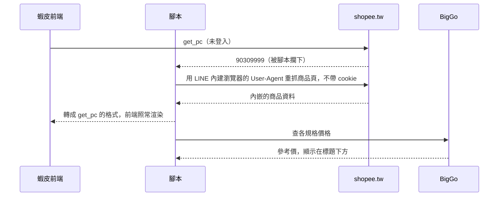

# Shopee Peek

[English](README.md) | **繁體中文** | [简体中文](README.zh-CN.md)

不登入也能看蝦皮台灣（shopee.tw）商品頁與站內搜尋第 1 頁的油猴腳本。商品與搜尋都用蝦皮原生版面顯示，商品標題下方附 BigGo 參考價。單一檔案、沒有相依套件、不追蹤使用者。

[](https://raw.githubusercontent.com/YTsnipers/shopee-peek/main/shopee-peek.user.js)
[](https://github.com/YTsnipers/shopee-peek/actions/workflows/check.yml)

[](LICENSE)

| 未安裝：被擋在登入頁 | 安裝後：顯示蝦皮原生商品頁 |
|---|---|
|  |  |

## 未登入時看得到什麼

| 看得到 | 看不到 |
|---|---|
| 商品標題、多圖輪播 | 銷量 |
| 規格選項 | 評價 |
| 商品規格表、商品描述 | 運送方式與運費 |
| 賣場名稱、回應率、粉絲數 | 即時價格（BigGo 價格可能落後） |
| 各規格 BigGo 參考價，隨選取的規格切換 | 搜尋第 2 頁以後、搜尋結果的價格 |
| 站內搜尋第 1 頁（最多 35 筆，含圖片與標題） | |

銷量、評價、運送是蝦皮伺服器對未登入訪客直接移除的，目前找不到其他來源。BigGo 沒收錄的商品會顯示「查無價格」。

## 安裝

1. 安裝 [Tampermonkey](https://www.tampermonkey.net/)
2. Chrome、Ego Lite、Brave、Edge：到 `chrome://extensions` → Tampermonkey → 詳細資料 → 打開「允許使用者腳本」（Allow User Scripts）
3. 開啟 [shopee-peek.user.js](https://raw.githubusercontent.com/YTsnipers/shopee-peek/main/shopee-peek.user.js)，Tampermonkey 會跳出安裝頁
4. （選配，網路層封鎖）匯入 [filters.txt](https://raw.githubusercontent.com/YTsnipers/shopee-peek/main/filters.txt)，在瀏覽器網路層直接攔截頁首雜項／熱搜詞／頁尾的請求與外連子網域連線：
   - **Brave**：打開 `brave://settings/shields/filters`，於「新增過濾清單網址」貼上上述 `filters.txt` 網址（或貼入檔案內容）
   - **Chrome / Ego Lite**：安裝 uBlock Origin 或 AdGuard 擴充功能，於自訂過濾清單匯入上述 `filters.txt` 網址

之後的新版由 Tampermonkey 自動安裝。

## 支援範圍

- 網站：只支援 shopee.tw
- 已測試：Brave、Ego Lite、Chrome + Tampermonkey；未測試：Edge、Firefox、Violentmonkey

## 運作原理

未登入時，蝦皮商品 API（`/api/v4/pdp/get_pc`）回 `90309999` 錯誤，前端接著把頁面導向登入牆。腳本在前端看到錯誤之前把回應換掉：



1. 在 `document-start` 攔截頁面的 `fetch`、`XMLHttpRequest`、`history`
2. `get_pc` 被擋時，用 LINE 內建瀏覽器的 User-Agent 重抓同一個商品頁。這個版本內嵌與 `get_pc` 同格式的商品資料，腳本把它交給蝦皮前端渲染
3. 從 `get_shop_base` 補上賣場資訊，其他被擋的 API 回空資料，並丟棄跳往 `/verify/` 的跳轉
4. 向 BigGo 查各規格價格，顯示在標題下方
5. 搜尋被擋時，向 BigGo 查詢蝦皮商城與拍賣商品，餵給蝦皮原生搜尋頁

登入狀態下蝦皮 API 不會回 `90309999`，腳本不替換任何資料。

細節見 [docs/how-it-works.md](docs/how-it-works.md)；試過哪些方法、為什麼失敗見 [docs/investigation-log.md](docs/investigation-log.md)。

## 資安與隱私

| 項目 | 實際行為 |
|---|---|
| 執行範圍 | 只在 `https://shopee.tw/*` 執行（`@match`） |
| 權限 | 只要求 `GM_xmlhttpRequest`，而且只能連 `shopee.tw` 與 `biggo.com.tw`（`@connect`） |
| 你的 cookie | 經 Tampermonkey 發出的請求一律不帶 cookie。只有賣場資訊（`get_shop_base`）在頁面內用蝦皮自己的 cookie 呼叫，和蝦皮前端平常發的請求相同 |
| 送到第三方的資料 | BigGo 會收到你正在看的商品 ID、商品名稱（或搜尋關鍵字）和你的 IP。帳號、cookie、瀏覽紀錄都不會送出 |
| 程式碼來源 | 單一檔案，沒有相依套件、沒有建置步驟，不下載遠端程式碼，沒有分析或追蹤 |
| 寫進頁面的外部資料 | BigGo 與蝦皮回傳的文字一律用 `textContent` 寫入，不會當成 HTML 解析 |
| 頁面與腳本的溝通 | 透過 `document` 事件。任何頁面上的腳本都能發這些事件，所以腳本先驗證參數（商品 ID 必須是數字、關鍵字不可空白、頁碼必須是非負整數）才發請求 |
| 自動更新 | Tampermonkey 從本 repo 的 `main` 分支更新，等於信任這個 repo 的維護者。不想自動更新，可以在 Tampermonkey 關掉這支腳本的「檢查更新」 |

會改變網站行為的地方：

- 沒有語言 cookie 時，設定 `language=zhHant`
- 隱藏並移除頁首左側工具列、右側「通知總覽／幫助中心」（保留語言、註冊、登入與帳號選單）、搜尋框下方熱搜關鍵字列及全站頁尾的連結與圖片屬性；發送前攔截對應 API（`get_footer_layout`、`/backend/CMS/footer/`、`search_prefills`、`search_suggestion?bundle=popsearch`、`notification/*`）並關閉瀏覽器連結 DNS 預解析（`x-dns-prefetch-control: off`）
- 阻擋頁面內連往 `seller.shopee.tw`、`help.shopee.tw`、`careers.shopee.com`、社群追蹤網域及跨國蝦皮站點的請求與跳轉
- 丟棄所有跳往 `/verify/` 的頁內跳轉，**登入時也一樣**。蝦皮要求驗證（包括驗證碼）時，頁面不會帶你過去；需要驗證就先停用腳本
- 搜尋結果的名稱與圖片網址暫存在 `sessionStorage`（`peek:` 開頭），關掉分頁就清除
- 所有送往 `/api/` 的 XHR 改由 `fetch` 發出

發現資安問題請開 issue 說明影響範圍，不要附上可以直接利用的細節。

## 疑難排解

| 狀況 | 原因 | 處理 |
|---|---|---|
| 還是跳到登入頁 | Tampermonkey 還不能執行使用者腳本，或蝦皮改版 | 檢查安裝第 2 步；已經打開就開 issue |
| 只出現標題、圖片、價格的精簡卡片 | 蝦皮對你的 IP 限流，拿不到完整商品資料 | 等一段時間再重新整理 |
| 搜尋一律顯示「找不到結果」 | BigGo 沒回傳搜尋結果，Console 出現 `[Shopee Peek] BigGo 搜尋失敗（HTTP ...）` | 稍後再試；若仍是 v0.6.0 舊版請更新至 v0.7.0 以上 |
| 標題下方顯示「查無價格」 | BigGo 沒收錄這個商品 | 不用處理，頁面其他部分正常 |
| 蝦皮要求驗證碼，頁面卻一直沒出現 | 腳本會丟棄所有跳往 `/verify/` 的頁內跳轉，登入時也一樣 | 這次瀏覽先停用腳本 |

回報問題時，打開開發者工具的 Console，篩選 `[Shopee Peek]`，把這些訊息連同商品網址貼到 issue。

### 限流

蝦皮會限制同一個 IP 透過腳本使用的路徑載入頁面的頻率。各路徑被限流時的樣子：

| 路徑 | 被限流時 | 畫面 |
|---|---|---|
| 商品資料（LINE User-Agent） | 回 HTTP 200，但內嵌資料的 `cachedMap` 是空的 | 顯示 BigGo 精簡卡，不是完整商品頁；Console 出現 `[Shopee Peek] LINE 版回傳空資料` |
| 搜尋（BigGo，v0.7.0+） | 不再請求 `shopee.tw/search`；舊版社群預覽 User-Agent（`facebookexternalhit`、`Twitterbot`、`Googlebot`）已被蝦皮封鎖，固定回 HTTP 403 + `90309999` | 由 BigGo 取得最多 35 筆結果，不消耗蝦皮 IP 額度；若 BigGo 回非 200，Console 出現 `[Shopee Peek] BigGo 搜尋失敗（HTTP ...）` |
| 首頁推薦 | 蝦皮回空資料，不是腳本造成的 | 限流範圍擴大時，首頁「每日新發現」也會變空 |

- 觸發與解除：先前的測試約 10 分鐘內開 8 次商品頁就觸發，約 30 分鐘後解除。另一次測試停用 65 分鐘後，商品頁仍是精簡卡、舊版社群預覽搜尋仍回 403，首頁推薦已恢復。再下一次測試停用約 1.5 小時後，商品頁已恢復完整，但舊版社群預覽搜尋超過 3 小時仍回 HTTP 403 + `90309999`（確認蝦皮直接封鎖該類 User-Agent，因此 v0.7.0 起搜尋改走 BigGo）。之後一次測試停用約 2.5 小時，商品頁兩次都完整載入，首頁推薦也有資料。
- 手動測試要間隔，不要連續開很多商品。
- 商品頁被限流後，等 30 分鐘到 2 小時再試。

## 給 AI 助手與 coding agent

想請 AI 解釋這個專案，把這個網址貼給它：

```text
https://raw.githubusercontent.com/YTsnipers/shopee-peek/main/llms.txt
```

要修改腳本的 coding agent，照這個順序讀：

| 檔案 | 內容 | 什麼時候讀 |
|---|---|---|
| [`llms.txt`](llms.txt) | 用途、行為、限制、檔案地圖（英文） | 第一次接觸專案 |
| [`AGENTS.md`](AGENTS.md) | 兩個執行環境、每件事唯一的寫法、不能破壞的規則與執法方式、驗收步驟（英文） | 改任何程式碼之前 |
| [`docs/how-it-works.md`](docs/how-it-works.md) | 封鎖機制、資料來源、請求流程（繁中） | 改請求或資料流程時 |
| [`docs/investigation-log.md`](docs/investigation-log.md) | 試過但失敗的方法與原因（繁中） | 提出新的繞過方式之前 |
| [`tests/`](tests) | 離線測試，在 Node `vm` 裡模擬瀏覽器與 Tampermonkey | 每次改動 |

規則與驗收步驟以 `AGENTS.md` 為準。實測會用掉使用者 IP 的蝦皮額度，能用離線測試驗的就不要實測。

## 開發與貢獻

```sh
node --check shopee-peek.user.js && node --test
```

CI 跑同一條指令，不需要安裝任何套件（Node 24）。

歡迎開 issue 與 PR。想移植到其他地區的蝦皮，先看 [`AGENTS.md`](AGENTS.md) 的「Hard-coded to Taiwan」清單；LINE User-Agent 這條路在台灣以外是否有效還沒測過。

腳本幫你省下一次登入的話，按個 star 能讓更多人找到它。

## 免責聲明

本腳本僅供個人瀏覽公開商品資訊，與 Shopee 及其關係企業無任何關聯。腳本依賴網站目前的運作方式，網站更新後可能隨時失效，作者不保證功能持續有效。使用者應自行評估使用風險並遵守網站服務條款，作者不對使用本腳本造成的任何後果負責。

## 授權

[MIT](LICENSE)
