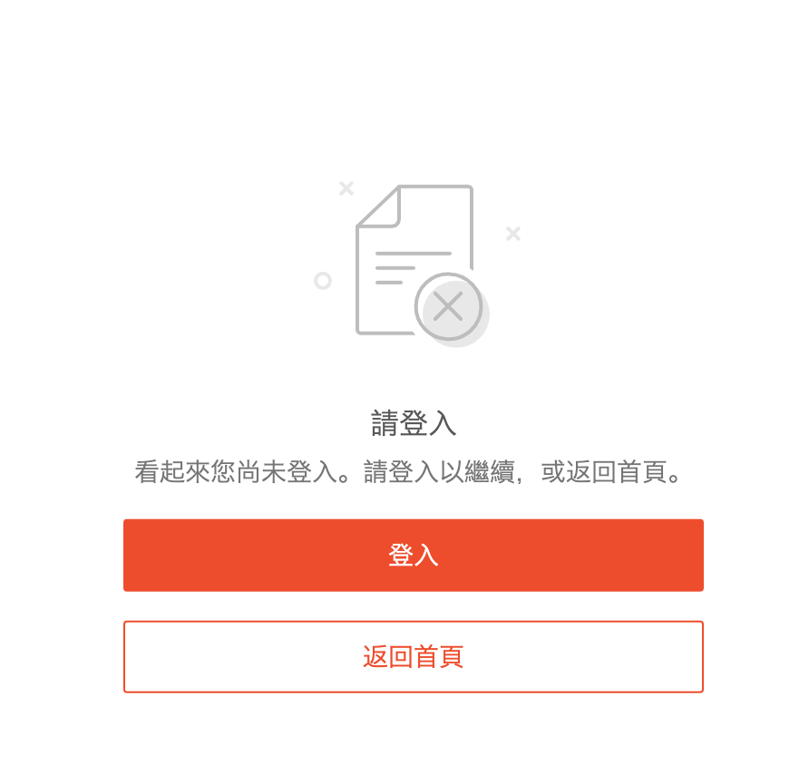
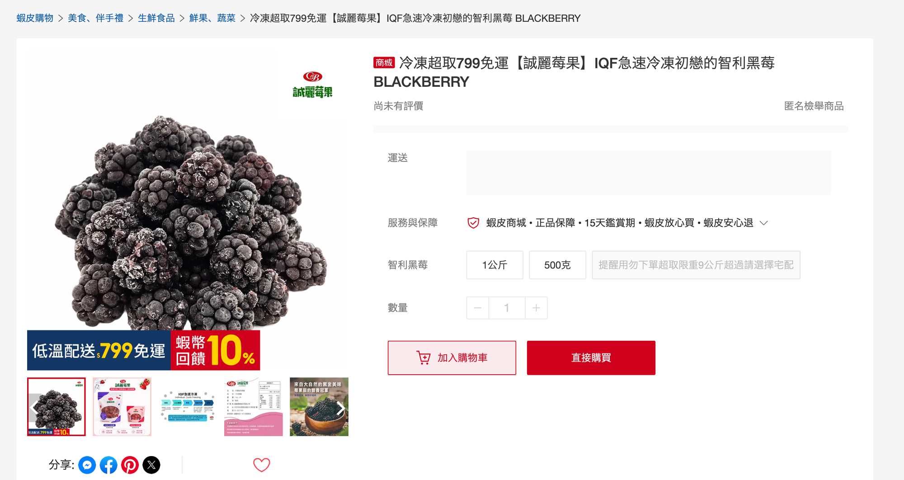

# Shopee Peek

[English](README.md) | **繁體中文** | [简体中文](README.zh-CN.md)

不登入也能看蝦皮台灣（shopee.tw）商品頁的油猴腳本。商品用蝦皮原生版面顯示，標題下方附 BigGo 參考價。

| 未安裝：被擋在登入頁 | 安裝後：顯示蝦皮原生商品頁 |
|---|---|
|  |  |

## 未登入時看得到什麼

| 看得到 | 看不到 |
|---|---|
| 商品標題、多圖輪播 | 銷量 |
| 規格選項 | 評價 |
| 商品規格表、商品描述 | 運送方式與運費 |
| 賣場名稱、回應率、粉絲數 | 即時價格（BigGo 價格可能落後） |
| 各規格 BigGo 參考價，隨選取的規格切換 | 搜尋第 2 頁以後、搜尋結果的價格 |
| 站內搜尋第 1 頁（10 筆，含圖片與標題） | |

銷量、評價、運送是蝦皮伺服器對未登入訪客直接移除的，目前找不到其他來源。BigGo 沒收錄的商品會顯示「查無價格」。

## 安裝

1. 安裝 [Tampermonkey](https://www.tampermonkey.net/)
2. Chrome、Brave、Edge：到 `chrome://extensions` → Tampermonkey → 詳細資料 → 打開「允許使用者腳本」（Allow User Scripts）
3. 開啟 [shopee-peek.user.js](https://raw.githubusercontent.com/YTsnipers/shopee-peek/main/shopee-peek.user.js)，Tampermonkey 會跳出安裝頁

之後的新版由 Tampermonkey 自動安裝。

## 支援範圍

- 網站：只支援 shopee.tw
- 已測試：Brave + Tampermonkey；未測試：Chrome、Edge、Firefox、Violentmonkey

## 疑難排解

| 狀況 | 原因 | 處理 |
|---|---|---|
| 還是跳到登入頁 | Tampermonkey 還不能執行使用者腳本，或蝦皮改版 | 檢查安裝第 2 步；已經打開就開 issue |
| 只出現標題、圖片、價格的精簡卡片 | 蝦皮對你的 IP 限流，拿不到完整商品資料 | 等一段時間再重新整理 |
| 標題下方顯示「查無價格」 | BigGo 沒收錄這個商品 | 不用處理，頁面其他部分正常 |
| 蝦皮要求驗證碼，頁面卻一直沒出現 | 腳本會丟棄所有跳往 `/verify/` 的頁內跳轉，登入時也一樣 | 這次瀏覽先停用腳本 |

回報問題時，打開開發者工具的 Console，篩選 `[Shopee Peek]`，把這些訊息連同商品網址貼到 issue。

### 限流

蝦皮會限制同一個 IP 透過腳本使用的路徑載入頁面的頻率。各路徑被限流時的樣子：

| 路徑 | 被限流時 | 畫面 |
|---|---|---|
| 商品資料（LINE User-Agent） | 回 HTTP 200，但內嵌資料的 `cachedMap` 是空的 | 顯示 BigGo 精簡卡，不是完整商品頁；Console 出現 `[Shopee Peek] LINE 版回傳空資料` |
| 搜尋（社群預覽 User-Agent） | `facebookexternalhit`、`Twitterbot`、`Googlebot` 都回 HTTP 403 + `90309999` | 搜尋頁顯示「找不到結果」 |
| 首頁推薦 | 蝦皮回空資料，不是腳本造成的 | 限流範圍擴大時，首頁「每日新發現」也會變空 |

- 觸發與解除：先前的測試約 10 分鐘內開 8 次商品頁就觸發，約 30 分鐘後解除。另一次測試停用 65 分鐘後，商品頁仍是精簡卡、搜尋仍是「找不到結果」，首頁推薦已恢復。
- 手動測試要間隔，不要連續開很多商品。
- 被限流後等 30 到 60 分鐘再試。

## 運作原理

未登入時，蝦皮商品 API（`/api/v4/pdp/get_pc`）回 `90309999` 錯誤，前端接著把頁面導向登入牆。腳本的處理：

1. 在 `document-start` 攔截頁面的 `fetch`、`XMLHttpRequest`、`history`
2. `get_pc` 被擋時，用 LINE 內建瀏覽器的 User-Agent 重抓同一個商品頁。這個版本內嵌與 `get_pc` 同格式的商品資料，腳本把它交給蝦皮前端渲染
3. 從 `get_shop_base` 補上賣場資訊，其他被擋的 API 回空資料，並丟棄跳往 `/verify/` 的跳轉
4. 向 BigGo 查各規格價格，顯示在標題下方
5. 搜尋被擋時，讀取搜尋頁的 `ItemList` 結構化資料，餵給蝦皮原生搜尋頁

登入狀態下蝦皮 API 不會回 `90309999`，腳本不替換任何資料。

細節見 [docs/how-it-works.md](docs/how-it-works.md)；試過哪些方法、為什麼失敗見 [docs/investigation-log.md](docs/investigation-log.md)。

## 給 AI 助手

- [`llms.txt`](llms.txt)：用途、行為、限制與檔案地圖整理在同一個檔案（英文）。想問 AI 這個專案，把 `https://raw.githubusercontent.com/YTsnipers/shopee-peek/main/llms.txt` 貼給它
- [`AGENTS.md`](AGENTS.md)：程式結構、不能破壞的規則與手動測試清單，給要修改腳本的 AI coding agent

## 參與貢獻

歡迎開 issue 與 PR。想移植到其他地區的蝦皮，先看 [`AGENTS.md`](AGENTS.md) 的「Hard-coded to Taiwan」清單；LINE User-Agent 這條路在台灣以外是否有效還沒測過。

腳本幫你省下一次登入的話，按個 star 能讓更多人找到它。

## 免責聲明

本腳本僅供個人瀏覽公開商品資訊，與 Shopee 及其關係企業無任何關聯。腳本依賴網站目前的運作方式，網站更新後可能隨時失效，作者不保證功能持續有效。使用者應自行評估使用風險並遵守網站服務條款，作者不對使用本腳本造成的任何後果負責。

## 授權

[MIT](LICENSE)
